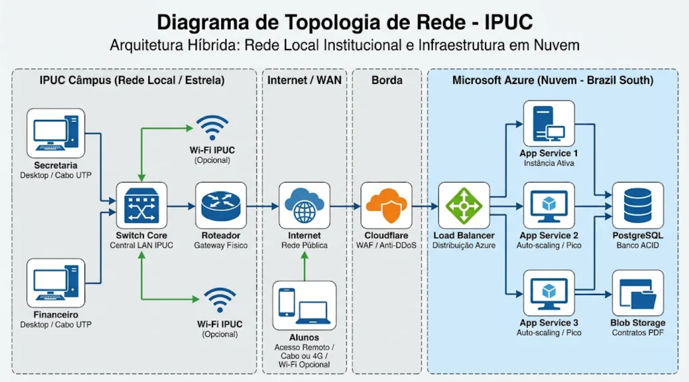

# 6. TOPOLOGIA DE REDE (Etapa 3)

A infraestrutura do sistema de rematrícula da IPUC baseia-se em uma arquitetura híbrida que interliga a rede local da instituição aos serviços em nuvem da Microsoft Azure, intermediados pelo Cloudflare.

## Identificação e Desenho da Topologia de Rede

A topologia adotada para o ambiente físico no câmpus da IPUC (onde operam a Secretaria Acadêmica e o Financeiro) é a **Topologia em Estrela** (Topologia do projeto híbrida). Nesse modelo, os computadores dos funcionários conectam-se a um equipamento central (Switch) via cabeamento físico UTP. O uso de rede Wi-Fi internamente é tratado como opcional, priorizando a estabilidade e segurança das conexões cabeadas para as operações críticas de secretaria e financeiro.

Para a comunicação externa e hospedagem do sistema, utiliza-se a arquitetura **Cliente-Servidor via Internet**. Os clientes (alunos em suas residências, seja via cabo, rede móvel 4G/5G ou Wi-Fi opcional, e funcionários na IPUC) requisitam acesso. O tráfego passa pela rede de borda (Cloudflare) e chega aos servidores lógicos (Azure App Service e banco de dados PostgreSQL).

## Tipos de Redes Utilizados pela Organização

O ecossistema do projeto transita por diferentes abrangências de rede para funcionar:
* **LAN (Local Area Network):** Utilizada fisicamente nos departamentos da IPUC (Secretaria e Financeiro). Conecta os desktops aos switches locais de forma cabeada para acesso à internet corporativa e sistemas internos.
* **WLAN (Wireless Local Area Network):** Trata-se de uma infraestrutura opcional e secundária no escopo deste projeto, tanto para o acesso dos alunos (que podem optar por redes cabeadas ou 4G/5G) quanto para o câmpus da IPUC, onde a rede administrativa prioriza meios guiados.
* **WAN (Wide Area Network) / Redes Interconectadas (Internet):** A infraestrutura principal que liga a rede local da IPUC e os alunos aos datacenters da Microsoft Azure (Região Brazil South) e aos nós globais da Cloudflare.

## Sinais da Rede e Meios de Transmissão

* **Sinais da Rede:** O sistema opera integralmente com sinais digitais, transmitindo dados binários empacotados nos protocolos da pilha TCP/IP (HTTP/HTTPS para navegação e consultas).
* **Meios Guiados (Com fio) - Prioritários:**
  * *Cabos de Par Trançado (UTP Cat6/Cat6a):* Conectam as estações de trabalho da secretaria e do financeiro aos switches da IPUC.
  * *Fibra Óptica:* Utilizada no backbone da instituição para ligar os switches ao roteador principal e nos links de internet (WAN) providos pelas operadoras até os datacenters.
* **Meios Não Guiados (Sem fio) - Opcionais:**
  * *Redes Celulares (4G/5G):* Meio alternativo frequentemente utilizado pelos alunos para acessar o portal de rematrícula remotamente.
  * *Ondas de Rádio (Wi-Fi):* Acesso secundário/opcional em ambientes residenciais ou de convidados.

## Processo de Planejamento, Desenvolvimento e Avaliação

O projeto foi construído sob uma metodologia baseada em nuvem e escalabilidade sob demanda, focada em alta disponibilidade para suportar picos de 1.900 acessos simultâneos.
* **Planejamento:** Realizado com base na arquitetura de microsserviços e responsabilidade compartilhada. A equipe desenhou a estrutura para que a gestão física ficasse a cargo da Microsoft, concentrando esforços no controle de acesso lógico e escalabilidade (SLA de 99,95%).
* **Desenvolvimento e Ferramentas:** A infraestrutura é gerenciada pelo painel do Microsoft Azure e Cloudflare. O banco de dados foi projetado com transações ACID (PostgreSQL). O Azure App Service lida com o auto-scaling, subindo de 1 para 3 instâncias de forma automatizada no pico de acessos.
* **Avaliação e Monitoramento:** O ambiente é constantemente avaliado através do Azure Monitor e do Health Check do App Service, que removem instâncias defeituosas da fila. O painel analítico do Cloudflare é utilizado para monitorar tentativas de ataques e consumo de banda.

## Normas, Segurança da Informação, Auditoria e Certificações

A infraestrutura foi alinhada às exigências legais e às melhores práticas internacionais de segurança da informação.
* **Principais Normas e Padrões:**
  * **LGPD (Lei Geral de Proteção de Dados):** Datacenter alocado no Brasil (Brazil South) por questões de soberania e conformidade. Uso de criptografia em trânsito (HTTPS) e em repouso (Blob Storage e PostgreSQL).
  * **ISO/IEC 27001:** Padrão internacional para Gestão de Segurança da Informação, atendido pela infraestrutura da Azure.
* **Processos de Auditoria:**
  * **Auditoria de Acessos:** O Microsoft Entra ID registra e audita todos os logins da IPUC. Anomalias disparam alertas e bloqueios.
  * **Auditoria de Tráfego:** O Cloudflare WAF audita em tempo real cada requisição HTTP (bloqueio de injeção de SQL ou XSS). Logs do banco (PITR) permitem auditoria temporal e recuperação.
* **Certificações:**
  * O projeto apoia-se nas certificações globais da Microsoft Azure e Cloudflare (SOC 1, 2 e 3, ISO 27001, ISO 27018, PCI-DSS). Os contratos digitais utilizam certificação ICP-Brasil ou plataformas com validade jurídica garantida.
