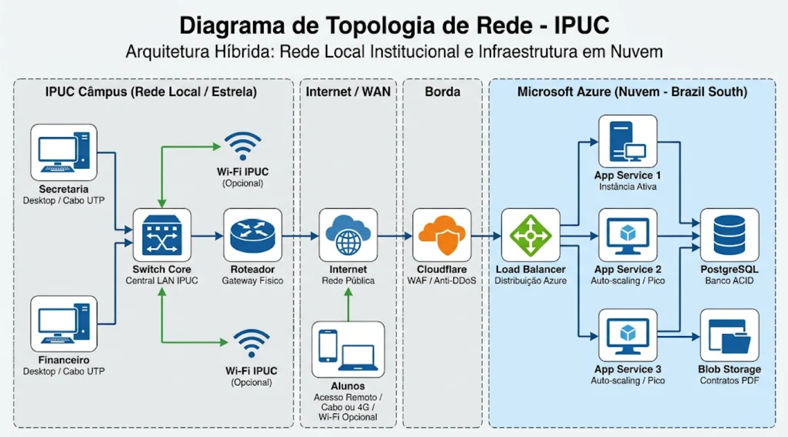

# 9 - APÊNDICES (Documentos produzidos pelos autores)

Este apêndice reúne os documentos, artefatos, modelos e o plano de pesquisa desenvolvidos pelos autores ao longo do projeto do Sistema de Rematrícula Acadêmica da IPUC, servindo de base para a fundamentação e execução técnica do trabalho.

---

## APÊNDICE A - Plano de Pesquisa (Etapa 4)

### 1. PROBLEMA DE PESQUISA
Com a consolidação da Sociedade em Rede (CASTELLS, 2021), as organizações dependem cada vez mais de Sistemas de Informação Gerenciais (SIG) para operacionalizar processos e suportar tomadas de decisão estratégica (LAUDON; LAUDON, 2014; ALEXANDER; KROENKE, 2018). No contexto do Instituto Politécnico da PUC Minas (IPUC), a automação do processo de rematrícula pelo Sistema de Gestão Acadêmica (SGA) gerou novos desafios de infraestrutura e usabilidade. 

As instituições de ensino enfrentam desafios operacionais recorrentes durante os períodos de rematrícula devido ao grande volume de informações geradas. Esse processo concentra um volume muito alto de acessos simultâneos (picos) em um curto espaço de tempo, gerando instabilidades, lentidão, sobrecarga no portal, e duplicação de dados entre os setores administrativos. Ademais, nota-se a presença de riscos como *Shadow IT* (uso não homologado de contas pessoais, WhatsApp e IAs públicas para dados confidenciais) e ameaças de engenharia social (phishing).

Nesse cenário, o problema de pesquisa que orienta este trabalho é: **Como garantir a alta disponibilidade, a integridade transacional e a segurança dos dados no Sistema de Rematrícula Acadêmica e na gestão de ativos da IPUC, equilibrando a eficiência exigida nos picos de acesso com os mecanismos técnicos de cibersegurança (STALLINGS, 2014) e as normativas de proteção de dados (LGPD, ISO/IEC 27002, NIST CSF)?**

### 2. PÚBLICO-ALVO
O público-alvo desta pesquisa abrange os usuários diretos dos sistemas desenvolvidos, bem como os profissionais técnicos e de gestão:
* **Alunos, Secretaria Acadêmica e Setor Financeiro da IPUC:** Usuários que dependem da estabilidade do portal web para efetivar matrículas, assinar contratos, gerar comprovantes e gerenciar o fluxo de caixa sem perda de dados (garantia ACID).
* **Gestores de TI e Administradores de Sistemas (TI Central):** Profissionais responsáveis pelo planejamento e operação da infraestrutura em nuvem (Azure), que necessitam garantir o *auto-scaling* para suportar os picos de acessos de forma viável, e aplicar o script de inventário (C#) para governança dos ativos Windows.
* **Especialistas em Cibersegurança:** Focados na aplicação de mecanismos de mitigação na borda (WAF e Anti-DDoS via Cloudflare) e proteção das redes corporativas locais (STALLINGS, 2014).
* **Encarregados de Proteção de Dados (DPO) e Consultores Jurídicos:** Profissionais envolvidos no cumprimento da LGPD (BRASIL, 2018), do Marco Civil da Internet e da MP 2.200-2/01.

### 3. DETERMINAÇÃO DOS OBJETIVOS
**Objetivo Geral:** 
A visão dos processos de negócios organizacionais voltada para o *core* de rematrícula e gestão institucional integra diretamente a segurança da informação ao ciclo operacional, conectando o fluxo estratégico às ferramentas desenvolvidas. O objetivo geral é analisar e estruturar uma arquitetura híbrida (nuvem) para o Sistema de Rematrícula Acadêmica, bem como desenvolver um Script em C# para o inventário de ativos, integrando os requisitos operacionais de alta disponibilidade às exigências de cibersegurança e conformidade com a LGPD.

**Objetivos Específicos:**
* **Mapear os requisitos operacionais e propor melhorias:** Identificar os gargalos (quedas, Shadow IT, phishing) e propor a substituição de estruturas locais sobrecarregadas por nuvem elástica e autenticação em duas etapas (MFA).
* **Projetar a infraestrutura (Topologia):** Desenhar a arquitetura em nuvem (Azure App Service e PostgreSQL) aliada à segurança de borda (Cloudflare) para garantir resiliência.
* **Desenvolver controles tecnológicos:** Criar um protótipo HTML que aplique conceitos de criptografia (SHA-256), defesa contra força bruta e prevenção a omissão de validação de dados; e desenvolver de forma segura um script C# CLI para o inventário de hardware/software, com armazenamento estruturado em arquivo `.dat`.
* **Avaliar a conformidade normativa:** Alinhar o projeto às Leis (Carolina Dieckmann, LGPD, Lei de Software) e aos preceitos da Tríade CID (Confidencialidade, Integridade e Disponibilidade).

### 4. METODOLOGIA
**i. Tipo de Pesquisa**
A pesquisa caracteriza-se como exploratória e descritiva. Exploratória ao buscar adaptar conceitos de nuvem elástica e desenvolvimento seguro de aplicações ao contexto do IPUC; descritiva ao detalhar os componentes arquitetônicos, mapeamento de processos (AS-IS e TO-BE), matrizes de risco e planos de contingência. A abordagem é qualitativa e aplicada.

**ii. Método da Pesquisa**
O método integra a pesquisa bibliográfica/documental com a modelagem de processos e sistemas:
* **Eixo de Sistemas e Infraestrutura:** Fundamentado em SIG (LAUDON; LAUDON, 2014) e documentações de nuvem (Microsoft Azure).
* **Eixo de Cibersegurança:** Princípios práticos de criptografia e proteção (STALLINGS, 2014).
* **Eixo Normativo:** ISO/IEC 27001/27002, NIST CSF e legislações vigentes.

**iii. Técnicas de Coleta de Dados**
* Levantamento bibliográfico (obras consagradas e leis).
* Mapeamento dos processos da Secretaria e TI (identificando gargalos como o uso de IAs públicas e WhatsApp para dados sensíveis).
* Prototipagem e modelagem de matrizes de risco/soluções.

### 5. UNIVERSO E AMOSTRA
O universo compreende a arquitetura de sistemas acadêmicos corporativos e a segurança em ambientes híbridos. A amostra restringe-se ao processo prático de Rematrícula do IPUC (comporta picos de até 1.900 alunos), sua modelagem de infraestrutura no Azure/Cloudflare e a aplicação das ferramentas desenvolvidas (Protótipo Web e Script C# de inventário).

### 6. INSTRUMENTOS DE COLETA DE DADOS
Análise documental, prototipação arquitetônica de diagramas de topologia (Visio/Draw.io), simulação de interface Web (HTML/JS com implementações lógicas de segurança), tabelas de mapeamento de processos de negócio e calculadoras de *pricing* para embasar custos.

### 7. RESULTADOS DA PESQUISA
Os resultados materializam-se na topologia híbrida de rede estruturada, na elaboração do código-fonte seguro do simulador de rematrícula, na criação do inventário via script C# (que elimina ferramentas shadow e automatiza registros locais) e nas análises de risco documentadas nos apêndices a seguir.

### 8. CONCLUSÕES
O diagnóstico demonstrou que a migração da infraestrutura local para uma nuvem elástica (Azure) intermediada por borda (Cloudflare) é a solução mais viável para sanar a instabilidade nos picos de matrícula do IPUC. A implementação de processos de conscientização e a centralização do inventário de TI por scripts nativos mitigam riscos de *Shadow IT* e invasões. Conclui-se que o modelo proposto assegura o cumprimento da LGPD, protegendo a instituição juridicamente e garantindo a privacidade dos discentes com base na tríade CID (Confidencialidade, Integridade e Disponibilidade).

---

## APÊNDICE B - Topologia de Rede e Arquitetura

A infraestrutura foi alinhada às exigências legais e às melhores práticas internacionais. A topologia adotada é **Híbrida** (Estrela no campus IPUC, conectada à nuvem).

* **Rede LAN (Câmpus IPUC):** Os desktops da Secretaria e Financeiro utilizam cabeamento físico UTP (priorizando estabilidade), com switches core protegidos.
* **Segurança de Borda:** Cloudflare Pro, atuando como WAF (Web Application Firewall) e mitigação contra ataques DDoS.
* **Nuvem (Azure - Brazil South):** Adoção de *Load Balancer* distribuindo requisições para o *App Service* (auto-scaling) e *Azure Database for PostgreSQL* (garantia transacional ACID). A hospedagem no Brasil obedece a premissas de soberania de dados da LGPD.

---

## APÊNDICE C - Análise de Riscos e Controles de Segurança

Tabelas derivadas da avaliação normativa baseada na ISO 27002, NIST CSF e regulamentações nacionais.

**Tabela de Análise de Segurança do Sistema:**
| Tipo de controle | Descrição | Responsável |
| :--- | :--- | :--- |
| **Controles de Software** | Tratamento de erros de digitação no menu do script em C# e estruturação limpa do código-fonte HTML/JS. | Equipe de Desenvolvimento |
| **Controles de Hardware** | Monitoramento de uso de CPU e memória do servidor (nuvem) para suportar picos de acessos simultâneos. | Infraestrutura / Suporte |
| **Processos Operacionais** | Controle de acesso por perfil (RBAC): aluno altera apenas seu pedido; atendente valida. | Administrador do Sistema |
| **Conscientização** | Orientação aos operadores contra phishing e restrição ao uso de WhatsApp/Shadow IT para dados de alunos. | Gestão do Projeto |
| **Backup e Auditoria** | Logs de alteração de status da rematrícula, backup diário e salvamento do inventário de ativos em `.dat`. | Analista de Banco de Dados / TI |

**Análise de Risco Estimada:**
| Tipo de exposição | Probabilidade | Estimativa de Impacto |
| :--- | :--- | :--- |
| **Falhas de Software / Injeção de Dados** | Média | **Alta:** Alteração indevida de dados acadêmicos e retrabalho manual. |
| **Sobrecarga de Hardware / Servidor** | Média/Alta | **Média:** Queda do portal e descumprimento de prazos de rematrícula. |
| **Falhas Operacionais e Shadow IT** | Baixa | **Alta:** Violação da LGPD e danos severos à reputação por vazamentos. |
| **Interrupção de Conexão ou DB** | Baixa | **Alta:** Perda de dados não salvos (mitigado pelo PostgreSQL ACID). |

---

## APÊNDICE D - Definição de Custos da Nuvem (CAPEX e OPEX)

A opção técnica pela nuvem (Microsoft Azure) justifica-se pela absorção de picos de cerca de 1.900 alunos quase simultâneos, sem a necessidade de adquirir e manter hardware físico ocioso pelo resto do ano.

**Tabela de Estimativa de Custos (Precificação Analisada):**

| Categoria | Item / Serviço Aplicado | Custo (R$) Estimado |
| :--- | :--- | :--- |
| **OPEX** | Cloudflare Pro (WAF/Anti-DDoS) | R$ 120,00 / Mês |
| **OPEX** | Azure App Service B2 (Auto-scaling 1 a 3 instâncias) | R$ 550,00 / Mês |
| **OPEX** | Azure Database for PostgreSQL (2 vCPU / 8 GB - ACID) | R$ 600,00 / Mês |
| **OPEX** | Azure Blob Storage (~100 GB) | R$ 60,00 / Mês |
| **OPEX** | Plataforma de assinatura eletrônica dos contratos | R$ 120,00 / Mês |
| **OPEX** | Administração do ambiente (rateio técnico) | R$ 1.500,00 / Mês |
| **OPEX** | Azure Monitor (métricas de saúde da rede) | R$ 60,00 / Mês |
| **OPEX** | Domínio corporativo e gestão DNS | R$ 40,00 / Anual |
| **CAPEX** | Setup Inicial (Config. do App, BD, Políticas e WAF) | R$ 8.000,00 (Único) |
| **TOTAIS** | **Custo Mensal Corrente (OPEX):** | **~ R$ 3.010,00 / Mês** |

---

## APÊNDICE E - Plano de Contingência Estrutural

Alinhado ao diagnóstico organizacional (Etapa 1) e aos modelos de sistemas (Etapa 2), estabeleceu-se as diretrizes de reação a incidentes:

| O que pode acontecer (Risco / Ameaça) | O que fazemos (Plano de Ação e Contingência) |
| :--- | :--- |
| **Pico massivo de acessos na rematrícula** | O *Load Balancer* divide a carga e o *auto-scaling* no Azure provisiona até 3 instâncias automaticamente. |
| **Ataque Distribuído de Negação de Serviço (DDoS)** | A infraestrutura global do Cloudflare absorve e mitiga o tráfego anômalo antes que ele atinja o portal no Azure. |
| **Tentativa de Injeção (SQLi / XSS)** | O WAF filtra os *payloads* maliciosos. O código-fonte realiza higienização (sanitize) de entradas (ex: máscara de RA). |
| **Falha técnica ou exclusão acidental de dados** | O banco PostgreSQL utiliza PITR (*Point-in-Time Recovery*), podendo voltar os dados ao estado de minutos antes da falha. |
| **Erro de digitação no Script de Inventário em C#** | O script conta com tratamento de exceções (blocos *try-catch*) para impedir o encerramento abrupto e salvar o `.dat`. |
| **Roubo de senhas por Engenharia Social (Phishing)** | Implementação de MFA (Múltiplo Fator) e campanhas de conscientização dentro do portal do IPUC para a comunidade acadêmica. |
| **Desastre no DataCenter do Azure no Brasil** | Recuperação Geográfica (*Georestore*) ativada para instanciar rapidamente backups em outra região. |

---

## ANEXOS

**Documentos e referências consultadas:**

* **Documentação de SLA da Microsoft Azure:**
  O Microsoft Azure garante alta disponibilidade com perímetro de latência de menos de dois milissegundos entre zonas de disponibilidade, contando com replicação síncrona e redundância física de energia, rede e resfriamento para proteção contra interrupções. A forma como os incidentes e o tempo de inatividade são calculados para reembolso ou cumprimento do Acordo de Nível de Serviço (SLA) estão detalhados nos termos operacionais da plataforma.
  Acesso ao documento oficial: [Zonas de disponibilidade do Azure – Alta disponibilidade em escala](https://azure.microsoft.com/pt-br/explore/global-infrastructure/availability-zones) e [Como ler um SLA - Microsoft Learn](https://learn.microsoft.com/pt-br/azure/reliability/concept-service-level-agreements).

* **Documentação de SLA do Cloudflare:**
  O Acordo de Nível de Serviço do Cloudflare Enterprise prevê garantias de tempo de resposta baseadas na prioridade do incidente (ex: resposta em até 30 minutos para problemas de Prioridade 1 no plano Premium).
  Acesso ao documento oficial: [Cloudflare Enterprise Customer Support and Service Level Agreement](https://www.cloudflare.com/pt-br/enterprise-support-sla/).

**Cópias/trechos das leis citadas:**

* **Lei Geral de Proteção de Dados (LGPD) - Lei nº 13.709/2018:**
  Dispõe sobre o tratamento de dados pessoais, inclusive nos meios digitais, por pessoa natural ou por pessoa jurídica de direito público ou privado, com o objetivo de proteger os direitos fundamentais de liberdade e de privacidade.
  Acesso ao texto na íntegra: [Lei nº 13.709, de 14 de agosto de 2018 - Presidência da República](http://www.planalto.gov.br/ccivil_03/_ato2015-2018/2018/lei/L13709.htm).

* **Medida Provisória nº 2.200-2/2001 (ICP-Brasil):**
  Institui a Infraestrutura de Chaves Públicas Brasileira. O Artigo 10, § 1º e § 2º, garante a validade jurídica de documentos eletrônicos assinados com certificados ICP-Brasil (presunção de veracidade) e também admite a validade de outros meios de comprovação de autoria e integridade (como assinaturas eletrônicas avançadas), desde que aceitos pelas partes.
  Acesso ao texto na íntegra: [Medida Provisória nº 2.200-2, de 24 de agosto de 2001 - Presidência da República](http://www.planalto.gov.br/ccivil_03/mpv/antigas_2001/2200-2.htm).
